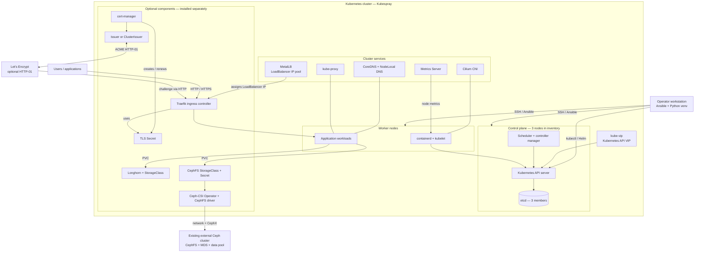

# Cluster infrastructure

The diagram describes the configured infrastructure and optional components. It is not a record of a successful deployment. Optional components are installed separately. Zabbix and its database stack are not implemented in this repository.

